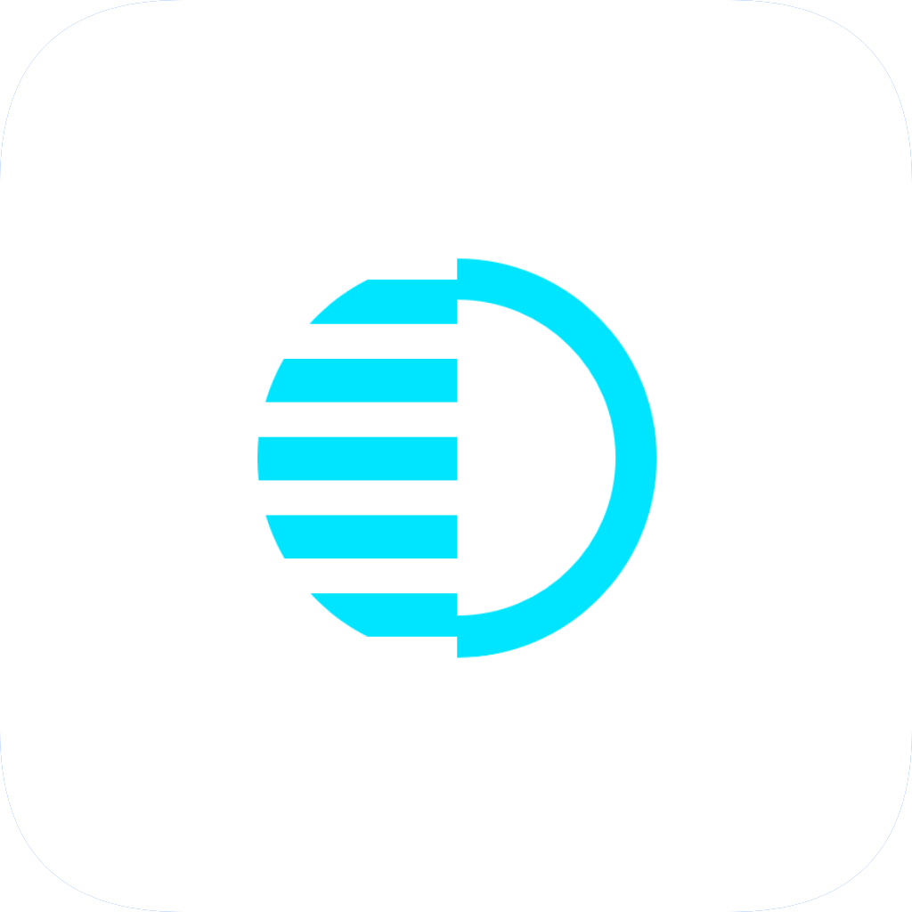

# Hikari

<p align="center">
  
</p>

<p align="center">
  <strong>Hikari</strong>
</p>

<p align="center">
  English | <a href="../README.md">Simplified Chinese</a>
</p>

Hikari is an Android status uploader that uses Shizuku to collect device state and upload it to a self-hosted API.

Current package name: `cafe.miafetta.hikari`. Current version: `2.0`.

## Overview

- Collect device model, battery, network, Wi-Fi, location, and foreground app data through Shizuku.
- Preview the upload payload on the main screen.
- Upload once manually or keep syncing through a foreground service.
- Filter foreground apps with blacklist or whitelist rules.
- Show a loading dialog while reading the installed app list.
- Stop automatic sync from either the notification or the main screen.

## Quick Start

1. Install and start Shizuku.
2. Grant Shizuku authorization to Hikari.
3. Configure the server API URL in settings.
4. Build the debug APK:

```powershell
.\gradlew.bat :app:assembleDebug
```

## Documentation

- [Building](BUILDING.md)
- [Design system](../DESIGN_SYSTEM.md)
- [Usage](USAGE.md)
- [Architecture](ARCHITECTURE.md)
- [Release process](RELEASES.md)
- [Contributing](../CONTRIBUTING.md)
- [Security](../SECURITY.md)
- [Changelog](../CHANGELOG.md)

## Repository Layout

```text
app/                     Android app source and resources
docs/                    English documentation and support notes
.github/                 Issue and pull request templates
CONTRIBUTING.md          Contribution workflow
SECURITY.md              Security disclosure policy
CHANGELOG.md             Change log
LICENSE                  Open-source license
```

## Related Projects

```text
Miafetta/hikari-android  <- current project
        |
        | uploads status
        v
Miafetta/hikari-api
        |
        | outputs cleaned status JSON
        v
Miafetta/miafetta.github.io
```

- [Miafetta/hikari-android](https://github.com/Miafetta/hikari-android): Android status collector and uploader, current project.
- [Miafetta/hikari-api](https://github.com/Miafetta/hikari-api): Status data processing API.
- [Miafetta/miafetta.github.io](https://github.com/Miafetta/miafetta.github.io): Blog display frontend.

## Privacy

Hikari can read and upload raw device status, including device model, battery output, network state, foreground app name, and recent location output. Review the payload preview before enabling automatic sync.

Only upload to a server you control and trust.

## License

Hikari is licensed under the GNU General Public License v3.0. See [LICENSE](../LICENSE) for details.
